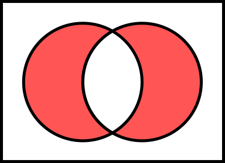

# 基本情報技術者試験の勉強メモ

ここには基本情報技術者試験の合格するために、勉強したことをメモしています。

基本上技術者試験はIPAが実施し、経済産業省が認定する日本の国家試験。

合格時のメリットとして、ITエンジニアに必要となる基礎的な知識が身につく。

試験の科目Aの分野は、テクノロジ系、マネジメント系、ストラテジ系の3つ。
最近はセキュリティに関する問題が多め。

科目Bの分野は、アルゴリズムとプログラミング、情報セキュリティの2つ。

## 基礎理論1

### データの単位

| 単位     | 記号 | 10進数表記        | 累乗    |
| -------- | ---- | ----------------- | ------- |
| テラ     | T    | 1,000,000,000,000 | 10**12  |
| ギガ     | G    | 1,000,000,000     | 10**9   |
| メガ     | M    | 1,000,000         | 10**6   |
| キロ     | K    | 1,000             | 10**3   |
| 基準     |      | 1                 | 1       |
| ミリ     | m    | 0.001             | 10**-3  |
| マイクロ | u    | 0.000001          | 10**-6  |
| ナノ     | n    | 0.000000001       | 10**-9  |
| ピコ     | p    | 0.000000000001    | 10**-12 |

### 数値の数え方

少数は整数部、少数部の2つに分かれる。

有限小数とは、少数部の桁数に限りがある少数。
無限小数とは、少数部の桁数に限りがない少数。
循環小数とは、同じ数字の列が無限に繰り返される少数。

### 基数変換と桁の重み

数値の表記法の変換を基数変換という。

指数とは数を掛け合わせる回数を表す数字。

1001.001=9.125、この少数部の計算は2-3乗は1/8なので125となる。

### 様々な基数変換

2bd.c8=701.78125、まず10進数に変換、桁の重みを乗算し、最後に足し合わせる。

10から2進数の場合、整数部では2で割って行き、あまりを加える。
少数部は少数を2でかけて行き、整数部を並べる。

10から16進数は10から2の計算方法と同じ。

### 負の2進数

2進数で負の整数を表す方法は、絶対値表現、1の補数表現、2の補数表現がある。

### 2進数の四則演算

2進数のシフト演算は、ビットを左右にずらして掛け算や割り算を行う計算手法。

論理シフトは正負を考慮せず、算術シフトは考慮を行う。

シフト演算は、例えばビットを左に2つずらすと、2**2=4倍になる。
そこに元のビットを加えると4+1=5倍となる。
そこに左に1つシフトすれば、5*2=10倍となり、計算が楽になる。

## 基礎理論2

### 集合と論理積

論理演算子には、AND,OR,XOR,NOTがある。

**AND演算子**

| A | B | A AND B |
| - | - | ------- |
| 0 | 0 | 0       |
| 0 | 1 | 0       |
| 1 | 0 | 0       |
| 1 | 1 | 1       |


**OR演算子**

| A | B | A OR B |
| - | - | ------ |
| 0 | 0 | 0      |
| 0 | 1 | 1      |
| 1 | 0 | 1      |
| 1 | 1 | 1      |


**XOR演算子**

| A | B | A XOR B |
| - | - | ------- |
| 0 | 0 | 0       |
| 0 | 1 | 1       |
| 1 | 0 | 1       |
| 1 | 1 | 0       |



**NOT演算子**

| A | NOT A |
| - | ----- |
| 1 | 0     |
| 0 | 1     |

そのほかに、NAND,NORがある。

**NAND演算子**

| A | B | A NAND B |
| - | - | -------- |
| 0 | 0 | 1        |
| 0 | 1 | 1        |
| 1 | 0 | 1        |
| 1 | 1 | 0        |


**NOR演算子**

| A | B | A NOR B |
| - | - | ------- |
| 0 | 0 | 1       |
| 0 | 1 | 0       |
| 1 | 0 | 0       |
| 1 | 1 | 0       |


論理演算子の優先順位は、括弧>NOT>AND>ORの順。

問題には、ベン図とビット列と16進数を組み合わせた計算が出てくる。

### 論理回路

論理回路とは、論理演算を行う電子部品。

MIL記号とは、論理回路を紙面上に表す際に使用される記号。

問題では複雑な論理回路が最終的にどのようなノン理演算を行っているかが主題される。

論理回路の問題では、ベン図を用いて解くと良い。

2進数の足し算を行う論理回路を加算回路という。

加算回路には、半加算器、全加算器の2種類がある。

半加算器は下のくらいからの桁上がりを考慮しない加算回路。

| 入力 | 出力 |
| ---- | ---- |
| X Y  | C S  |
| 0 0  | 0 0  |
| 0 1  | 0 1  |
| 1 0  | 0 1  |
| 1 1  | 1 0  |

全加算器は下のくらいからの桁上がりを考慮する加算回路。

| 入力  | 出力 |
| ----- | ---- |
| X Y Z | C S  |
| 0 0 0 | 0 0  |
| 0 0 1 | 0 1  |
| 0 1 0 | 0 1  |
| 0 1 1 | 1 0  |
| 1 0 0 | 0 1  |
| 1 0 1 | 1 0  |
| 1 1 0 | 1 0  |
| 1 1 1 | 1 1  |

半加算器は論理積と排他的論理和で実現する。

### 計算式の表し方

計算式を表す方法には、中置記法、前置記法、後置記法がある。

中置記法とは、おなじみの記法。

Y=(A+B)X(C-D/E)

前置記法とは、数字の前に演算子を置く表記法で、ポーランド表記法とも呼ばれる。

Y+AB/-XCDE=

後置記法とは、数字の後に演算子を置く表記法で、逆ポーランド表記法とも呼ばれる。

YAB+CDE/-X=

### オートマトン

モデル化とは、現実世界にある複雑なものを単純化してわかりやすくすること。

オートマトンとは、機能を、入力、状態、出力の3つを表すシステムモデル。

オートマトンの状態で、最終的に行き着く状態のことを、受理状態という。

このような状態の遷移を表した表を状態遷移表、図を状態遷移図という。

問題では表、図が示され最終的な状態は何かが問われる。

### 人工知能

AI（人工知能）とは、人間の知的な振る舞いをコンピューター乗に再現する技術。

主な用途に、画像の認識・合成、自然言語処理、音声の認識・合成がある。

重要な用語は以下の通り。

- 機械学習
- ニューラルネットワーク
- ディープラーニング
- 生成AI

ニューラルネットワークの基本的な計算隊はニューロンで、プログラム乗で関数として実装される。

このニューロンに渡す値を出力する関数のことを活性化関数という。

ディープフェイクとは、本物みたいな偽物の音声や動画を作成する手法。

ハルシネーションとは、誤った情報を正しい情報として生成する現象。

ファインチューニングとは、AIに追加学習を行うこと。

## アルゴリズムとプログラミング

## データ構造

コンピューターが扱う情報のことをデータという。

データはコンピューター内にある主記憶装置に保存される。

この記憶装置乗のデータの並べ方をデータ構造という。

データ構造には、スタック、キュー、配列、連結リスト、木構造がある。


__スタック__

- 最後に格納したデータを最初に取り出すデータ構造（積み上げられた本）
- スタックにデータを格納することをプッシュ、取り出すことをポップという。
- アルゴリズムは後入れ先出し（LIFO: Last In First Out）

__キュー__

- 最初に格納したデータを最初に取り出すデータ構造（レジ待ちの列）
- キューにデータを格納することをエンキュー、取り出すことをデキューという。
- アルゴリズムは先入先出し（FIFO: First In First Out）

__配列__

- データを表の形に並べたデータ構造。
- 配列では1つ1つを要素、位置を表す番号を要素番号という。
- 配列で要素が一直線に並ぶ配列を1次元配列、縦横に並ぶ配列を2次元配列という。

__連結リスト__

- データを数珠繋ぎに並べたデータ構造
- 連結リストのポインタとは、次の要素のアドレスを指し示すもの。
- 配列と連結リストの違いは、配列は参照と更新が速く、連結リストは挿入と削除が速い。

__木構造__

- 階層構造を持つデータ構造。
- 最上位の節を根、枝分かれする箇所を節、末端を葉と呼ぶ。
- ２分探索木とは、左の子孫＜親＜右の子孫の関係になっていることをいう。
- 木構造で大小関係を求められた場合は、右から左と覚えておくと良い。

### アルゴリズムの基本

アルゴリズムとは、問題を解決するときの手順。

アルゴリズムには、文章、流れ図、数式、プログラム言語の4つの方法で表現することができる。

問題では、流れ図が最も頻繁に出題される。

#### 文章

```
1. x<0ならば2へ。x>=0ならば3へ
2. -x->x
3. xを返す
```

#### 流れ図

| 記号名   | 形     | 役割                             |
| ------   | ------ | -------------------------------- |
| 端子     | 楕円形 | 流れ図の開始と終了を表す         |
| 処理     | 四角形 | 計算や値の代入といった処理を表す |
| 判断     | ひし形 | 処理を分岐するための条件を表す   |
| 線       | 線形   | 処理の順番を表す                 |
| ループ端 | 台形   | 繰り返し処理の開始と終了を表す   |

#### 数式

```
      |- -x (x<0の時)
f(x)=-|
      |- x (x>=0の時)
```

#### プログラム言語

```sh
f(x): if x < 0 then return -x else return x
```

### アルゴリズムの分類

試験では、整列、探索、再帰的アルゴリズムが出題される。

#### 整列アルゴリズム

整列アルゴリズムとは、データを特定の順番に並べるアルゴリズム。

主な整列アルゴリズムは以下の4つで、特にクイックソートが最も出題される。

| 種類           | 解説                                           |
| -------------- | ---------------------------------------------- |
| バブルソート   | 隣り合ったデータを比較する                     |
| 選択ソート     | 先頭から順に最小値を選択し、データを交換する   |
| 挿入ソート     | 未整列のデータを適切な場所に挿入する           |
| クイックソート | 基準値を決めて、それより大小のグループに分ける |

#### 探索アルゴリズム

探索アルゴリズムには以下の種類がある。

特にハッシュ法、2分探索法がよく出題される。

| 種類       | 説明                         |
| ---------- | ---------------------------- |
| 線形探索法 | 先頭から順に1つずつ照合する  |
| ハッシュ法 | ハッシュ表を使用する         |
| 2分探索法  | 調べる範囲を半分に切り分ける |

ハッシュ法ではまず、ハッシュ関数を使って値をハッシュ値に変換します。
そしてハッシュ値を要素番号とした配列の要素に格納される。
ハッシュ法のデメリットは、衝突が起こる可能性があること。

2分探索法には、データをあらかじめ整列する必要がある、2つに分けながら探索するという特徴があります。

再帰的アルゴリズムとは、処理の途中で自分自身を呼び出すアルゴリズム。

試験では総和、剰余、階上を求める際に出題される。

総和はΣ、剰余はmod、階乗は!で表す。

アルゴリズムを完了するために必要な計算量をオーダーという。

| アルゴリズム   | オーダー記法         |
| -------------- | -------------------- |
| ハッシュ法     | O(1)                 |
| 2分探索法      | O(log2n) or O(log n) |
| 線形探索法     | O(n)                 |
| クイックソート | O(n log n)           |

表の`log`は対数を表すキーワードで、指数を表す1つの方法です。

### プログラムの性質と種類

プログラムとは、コンピューターに対する命令書。

プログラムの性質には以下の4つがある。

この中で、再起、再入可能がよく試験で出題される。

| 性質       | 説明                                             |
| ---------- | ------------------------------------------------ |
| 再帰       | 自分自身を呼び出す性質                           |
| 再入可能   | 複数のプログラムからの同時呼び出しに対応可能     |
| 再配置可能 | 主記憶装置に保存していればどこでも実行が可能     |
| 再使用可能 | 主記憶に保存して主記憶装置から繰り返し実行できる |

Javaアプレットとは、Webブラウザ上で実行可能なプログラム。

Javaサーブレットとは、動的なWebページを作るためのプログラム。

JavaBeansとは、コンポーネント化されたプログラム。

### その他の言語

HTMLはマークアップ言語。

XMLはHTMLと違い拡張が可能（タグを自分で定義できる）。

CSSはHTMLのスタイルを指定する言語。

Ajax(Asynchronous JavaScript and XML)とは、画面遷移せずに動的なUIを実現する技術。

## コンピュータの構成要素

### CPU（プロセッサ）

CPU(Central Processing Unit：中央処理装置)とは、コンピュータの中心で仕事をする機械。

CPUの性能は、黒く周波数、MIPS、コアで評価される。

__クロック周波数__

- CPUの動作の速さを表す指標。
- 単位はヘルツで、1秒間に発生させる信号の回数で速さを表す。
- 式：`2.5GHz=2,500,000,000クロック`

__MIPS__

- CPUが1秒間に何個の命令を実行できるかを表す単位。
- 式：`MIPS=1秒/平均実行時間*10-6乗`

__コア__

- CPU内にある演算を行う装置
- 複数のコアを持つCPUをマルチプロセッサ
- 2つのコアを持つプロセッサをデュアルプロセッサ
- 4つのコアを持つプロセッサをクアッドプロセッサ


### CPUが処理する流れ

主記憶装置とは、命令やデータを格納しておく装置。

CPUはアドレスを指定して、主記憶装置から命令やデータを取り出す。

格納されたデータは、命令部とアドレス部で構成される。

レジスタとは、CPU内にある命令やデータを一時的に格納する記憶装置。

主なレジスタの種類は以下のとおり。

- プログラムカウンタ - 次の命令のアドレスを格納するレジスタ
- 命令レジスタ - 命令を格納するレジスタ
- 汎用レジスタ - データを格納するレジスタ

試験では各レジスタの名前や、その役割が出題される。

__CPUの処理の流れ__

1. CPUが主記憶装置に、次の命令のアドレスに命令を取りにいく
2. CPUが次の命令のアドレスに更新を行う
3. 主記憶装置がCPUに、命令を命令レジスタに格納する
4. CPUが命令を命令デコーダで解読する
5. CPUが主記憶装置に、アドレス部に書かれたデータを取りに行く
6. 主記憶装置がCPUに、データを汎用レジスタに格納する

アドレス指定方式には、直接アドレス指定と間接アドレス指定の2種類がある。

直接アドレス指定とは、アドレス部に有効アドレスが入っている方式。

有効アドレスとは、CPUの処理対象となるデータが格納されているアドレス。

間接アドレス指定とは、主記憶装置上にある有効アドレスの場所を示す値が入っている方式。

試験に出るのは主に上記の2つの方式だが他にも様々な方式がある。

- 指標アドレス指定：インデックスレジスタの値を加算した値を有効アドレスとする方式。
- ベースアドレス指定：ベースレジスタの値を加算した値を有効アドレスとする方式。
- 相対アドレス指定：プログラムカウンタの値を加算した値を有効アドレスとする方式。
- 即値アドレス指定 ：アドレス部にデータそのものが入っている方式。

割り込みとは、実行中のプログラムを中断して別のプログラムに切り替えること。

割り込みの目的は、優先度の高い命令があった場合に、その処理を優先することで効率よくCPUを利用すること。

割り込みには、内部割り込みと外部割り込みがある。

内部割り込みは、実行中のプログラムで発生する。

- プログラム割り込み：プログラムエラーによって起きる割り込み
- スーパーバイザーコール割り込み：OSの機能を呼ぶときの割り込み
- ページフォルト：仮想記憶管理での、主記憶装置に存在しないページのアクセス

外部割り込みは、実行中のプログラム以外で発生する。

- タイマ割り込み：CPUのタイマによって発生する割り込み
- 入出力割り込み：入出力が完了したことによる割り込み
- 機械チェック割り込み：装置内の検査によって異常を検出したときに起こる割り込み
- コンソール割り込み：コンソールから処理要求を出したときに発生する割り込み

試験ではこの割り込みが内部または外部なのかといった問題が出題される。

### さまざまな記憶装置

メモリとは記憶装置のことで、試験では主に以下の項目が出題される。

- キャッシュメモリ
- ヒット率
- ライトスルー方式
- ライトおバック方式

コンピューターに搭載されている記憶装置は以下の通り。

- 主記憶装置
- 補助記憶装置
- キャッシュメモリ

__主記憶装置__

- CPUが直接読み書きができる記憶装置。
- 役割は命令やデータを一時的に格納できること。
- 特徴はデータを高速に出し入れが可能で、電源を切るとデータが消滅すること。

__補助記憶装置__

- 主記憶装置を補助するための記憶装置。

- 役割はデータを長期的に保存すること（電源を切ってもデータが消滅しない）。

__キャッシュメモリ__

- CPUと主記憶装置の間にある超高速の記憶装置。
- キャッシュメモリは主記憶装置よりも速度がはやい。

ヒット率とは、必要なデータがキャッシュメモリ上に配置されている確率。

アクセス時間とは、CPUが主記憶装置とデータをやり取りする際にかかる時間。

実効アクセス時間とは、またキャッシュメモリを使用した時のアクセス時間。

```
# 実効アクセス時間 =
# キャッシュメモリのアクセス時間 * ヒット率 +
# 主記憶装置のアクセス時間 * (1-ヒット率)

キャッシュメモリへのアクセス時間 = 20ns
主記憶装置へのアクセス時間 = 580ns
キャッシュメモリへのヒット率 = 0.9

実行アクセス時間 = 20 * 0.9 + 580 * (1 - 0.9) = 76ns
```

メモリインタリーブとは、CPUから主記憶装置へのアクセス時間高速化のために、
主記憶装置内部に複数のバンクと呼ばれる単位に分割し、
各バンクに並列にアクセスすること。

データの書き込み方式には、ライトスルー方式とライトバック方式がある。

__ライトスルー方式__

- CPUがキャッシュメモリと主記憶装置の両方にデータを書き込む方式。
- 書き込みは、即時行われる。
- メリットは仕組みがシンプルであること。

__ライトバック方式__

- キャッシュメモリから不要なデータを追い出す際に、主記憶装置に書き込む方式。
- 書き込みは、キャッシュメモリからデータを追い出すときに行われる
- メリットは書き込み速度が速いこと。

### 入出力インターフェース

機器と機器をつなぐ際に使用する、ケーブルの接続口の形状やデータをやり取りする方式のこと。

入出力インターフェースには有線、無線のいずれかに分類できる。

- 入出力インターフェース
    - 有線
        - USB
        - HTMI
    - 無線
        - Bluetooth
        - RFID

有線には2種類の伝送方法に分類できる。

シリアルインターフェースとは、1本の信号線で1ビットずつ順にやり取りする規格。

パラレルインターフェースとは、複数の信号線で複数のビットを並列にやり取りする規格。

実はパラレルインターフェースよりシリアルインターフェースの方が高速で主流。

__USB(Universal Serial Bus)__

- 多くの周辺機器を接続できる入出力インターフェース。
- 伝送方法はシリアルインターフェース。
- USB1.0: 12Mbps
- USB2.0: 480Mbps
- USB3.0: 5Gbps
- コネクタ形状は同じ規格内であっても複数種類がある（Type C）

試験でもUSB関連の問題がよく出る。

PCと周辺機器を接続する方法には、スター接続、ツリー接続、デイジーチェーン接続がある。

スター接続とは、PCのコネクタに複数の周辺機器を接続する方法。

ツリー接続とは、ハブを使用して周辺機器を枝分かれさせて接続する方法。

デイジーチェーン接続とは、周辺機器を数珠繋ぎで接続する方法。

メリットはハブが不要で、配線がスッキリすること。

デメリットは周辺機器が多くなると、伝送速度が落ちること。

デバイスドライバはPCに接続された周辺機器を制御するソフトウェア。

### 入出力装置

入出力装置には、キーボード、ディスプレイ、プリンターなどがある。

試験では、dpi、3Dプリンターがよく出題される。

入力装置とは、コンピュータにデータを入力するための装置。

出力装置とは、コンピュータの処理結果を表示するための装置。

ディスプレイは、コンピュータが処理した結果などを表示する装置。

dpi(dot per inch)とは、1インチあたりのドットの数を表す単位。

いくつドットが並ぶのかを表すのであって、含まれているドットの数を表すわけではないので注意。

ポイントとは、文字の大きさを表す単位（1ポイント＝1/72インチ(0.35mm)）

3Dプリンターとは、3次元のデータを元にして立体物を造形する機械。

出力方式は以下の通り。

- 熱溶解積層方式：熱で溶かした樹脂を積み重ねる方式
- 光造形方式：液体状の樹脂に紫外線などを当てて固める方式
- 粉末固着方式：粉末状の樹脂に接着剤を吹き付けて固める方式

## システムの構成要素

### 処理の仕方によるシステムの分類

システムとは、これまで手作業で行なっていた仕事を、コンピューターで自動化する仕組み。

システムには、集中処理と分散処理の処理形態がある。

集中処理とは、1つのコンピュータに複数の端末を接続し、命令を1つのコンピュータが処理を行う形態。

この処理を行う1つのコンピュータをホストコンピュータという。

分散処理とは、複数のコンピュータが処理を分担して行うシステム。

分散処理には、主に以下の種類がある。

- クライアントサーバーシステム
- 3層クライアントサーバーシステム
- ウェブシステム

__クライアントサーバーシステム__

- クライアントが処理要求をサーバーに送り、サーバーが処理を行う分散処理システム。

__3層クライアントサーバーシステム__

- クライアントサーバーシステムを3つの層に分けたシステム。

- 3層とは、クライアント、アプリケーションサーバー、データベースサーバーのこと。

__ウェブシステム__

- インターネットとウェブブラウザを利用するシステム。
- メリットはユーザーが使い慣れたウェブブラウザを使用できること。
- ウェブシステムの処理の流れ
    1. クライアントがウェブブラウザで、サーバーに処理を要求する。
    2. サーバーはデータベースとやり取りを行う。
    3. 処理結果をHTML形式で、クライアントに渡す。
    4. クライアントのウェブブラウザで、HTMLを表示する

### システム構成によるシステムの分類

システム構成の分類は主に以下の3種類に分類される。

シンプレックスシステムとは、1つのコンピューターだけのシステム構成。

デュプレックスシステムとは、動作するコンピューターと待機しているコンピューターの2つからなるシステム構成。

デュアルシステムとは、2つのコンピューターが同じ処理を行い、結果を照合して正しいことを確認するシステム構成。

試験では動いているコンピュータを現用系、待機しているコンピュータを待機系という。

ホットスタンバイとは、現用系と待機系のどちらも電源を入れておき、データやプログラムを同期しておく動作状態。

もしも障害が起きた時でも、すぐに対応できるのがポイント。

コールドスタンバイとは、待機系には電源を入れずに停止した状態で置いておく構成。

待機系が停止しているので、障害が起きてもすぐには対応できないのがポイント。

フォールトトレラントとは、システムが部分的に故障してもシステム全体としては、必要な機能を維持する設計のこと。

考え方として、あるコンピュータが故障してもシステムとしては稼働を続けられるようにすることが大事。

フォールトトレラントには信頼性に関する用語に主に以下のようなものがある。

- フェールソフト：たとえ性能が落ちてもシステム全体を動作させる設計。
- フェールセーフ：システムを止めてでも安全を優先させる設計。
- フールプルーフ：人為的なミスでもシステムが壊れないようにする設計。

障害に強いシステムの構成に、ハードディスクの構成に関するレイドという技術がある。

RAID(Redundant Arrays if Inexpensive Disks)とは、複数のハードディスクをあたかも1つのハードディスクであるかのように扱う技術の総称。

RAIDにはRAID0~RAID6までの7つのレベルがある。

- RAID0：データを複数のハードディスクに分散して書き込む記憶方式（ストライピング）
- RAID1：複数のハードディスクに同じデータを書き込む記憶方式（ミラーリング）
- RAID2：データにハミングコード（誤り訂正符号）を加えて複数のディスクに分散して書き込む記憶方式
- RAID3：誤り訂正符号を専用のディスクに書き込み、データは分散して書き込む記憶方式
- RAID4：RAID3の記憶方式にデータの分割をブロック単位で行う記憶方式。
- RAID5：データにパリティ（誤り訂正符号）を加えて、データを分散して書き込む記憶方式。
- RAID6：RAID5の記憶方式にパリティを2重で生成する記憶方式

ストライピングとは、データを複数のハードディスクに分散させて書き込む記憶方式。

特徴は、読み書き速度が高速化できる代わりに、1つのディスクが壊れると全体が動作しなくなること。

ミラーリングとは、複数のハードディスクに同じデータを書き込む記憶方式。

特徴はディスクが1つ壊れても動作するが、処理速度が遅くなる。

### システムの性能指標

システムの性能を評価する主な指標には、スループット、ターンアラウンドタイム、レスポンスタイムの3種類がある。

スループットとは、システムが単位時間あたりに処理する仕事の量を表す。

例えば、印刷ページ数÷最後のページを印刷するまでの時間=スループット

ターンアラウンドタイムとは、入力＋処理＋出力の時間。

レスポンスタイムとは、ターンアラウンドタイムの処理のみの時間。

ベンチマークテストとは、システムの性能を比較するために行うテスト。

主に標準的なプログラムやデータを用いて性能を測る。

キャパシティプランニングとは、システムの稼働状況を継続的に評価し、システムに求められる処理能力を計画すること。

このプランニングで処理能力の向上が必要なときに、スケールアウトとスケールアップの2つの手段を実行する。

スケールアウトとは、サーバーの台数を増やすことでシステム全体の処理能力を向上させること。

スケールアップとは、サーバー自体の処理能力を向上させることでシステム全体の処理能力を向上させること。

### システムの信頼性指標

試験では稼働率を計算する問題がよく出る。

RASISとはシステムを評価するための5つの指標。

| 指標           | 意味   | 説明                                   |
| -------------- | ------ | -------------------------------------- |
| Reliability    | 信頼性 | 障害の起こりにくさ                     |
| Availability   | 可用性 | いつでもサービスが利用できるかどうか   |
| Serviceability | 保守性 | 復旧のしやすさ                         |
| Integrity      | 完全性 | データが壊れたり、改ざんが行われないか |
| Security       | 安全性 | 許可された人のみアクセスできるか       |

__MTBF(Mean Time Between Failures：平均故障間隔)__

- システムが故障せずに動いていた時間の平均値。
- 式：MTBF=稼働時間/故障回数
- MTBFを高めるメンテナンスのことを予防保守という。

__MTTR（Mean Time to Repair：平均修復時間）__

- システムが稼働していなかった時間の平均値。
- 式：MTTR=故障時間/故障回数

__稼働率__

- システムが故障せずに動いていた時間の割合。
- 式：稼働率=MTBF/(MTBF+MTTR)

システムを構成する装置の配置方法には、直列システム、並列システム、多重化システムの3種類がある。

直列システムとは、複数の装置が直列に接続されたシステム。

直列システムの稼働率=装置Aの稼働率X装置Bの稼働率

並列システムとは、複数の装置が並列に接続されたシステム。

並列システムの稼働率=1-(1-装置Aの稼働率)X(1-装置Bの稼働率)

多重化システムとは、直列システムと並列システムを組み合わせた1つのシステム。

多重化システムの稼働率=各システムの稼働率から全体の稼働率を計算する。

```
装置A
- 稼働時間合計：390
- 故障回数：3
- 故障時間合計：180
装置B
- 稼働率：0.8

装置A
- MTBF=390/3=130
- MTTR=180/3=90
- 稼働率=130/(130+90)=0.68

AとBの直列システムの稼働率=0.9*0.8=0.72
AとBの並列システムの稼働率=1-(1-0.9)*(1-0.8)=0.98
直列システムと並列システムの多重化システムの稼働率=0.72*0.98=0.71
```

## ソフトウェア

### オペレーティングシステム

システムはハードウェアとソフトウェアから構成されている。

ソフトウェアはさらにOSとアプリケーションソフトウェアの2つに分類できる。

OSとはアプリケーションソフトウェアとハードウェアの間で処理を仲介するソフトウェア。

試験では、ジョブ管理、タスク管理、記憶管理、データ管理の4つの機能に関する問題が出題される。

#### ジョブ管理

- ジョブの実行順序を管理する機能。
- ジョブとは、ユーザーがコンピュータに依頼する仕事の単位。
- ジョブはOSが取り扱っており、単位をCPUに渡して処理を実行してもらう。
> ジョブ管理は処理の順番を管理することで、CPUが最大限機能を発揮するのに必要な機能。

__スプーリング__

- CPUと低速の入出力装置の間のデータ転送を高速の補助記憶装置に注解させる技術。
- スプーリングは処理時間の遅いプリンターの印刷時によく使われる。

__バッファ__

- データを一時的に保存する記憶装置。
- 緩衝記憶装置とも呼ばれ、名前の通り処理速度や伝送速度の異なる2つの装置の差を緩和する機能。
- キャッシュメモリやディスクキャッシュもバッファの1つ。

#### タスク管理

- タスクの実行順序を管理する機能。
- タスクとは、OSがCPUに出す命令の単位。
- マルチタスクとは、複数のタスクを頻繁に素早く切り替えることにより、同時に実行しているかのように見せる技術。
> なぜ同時に実行しているかのように見せるかというと、本来CPUは1つのコアで1つの作業しかできないからである。
>そのためマルチタスクを使うことで、CPUが1つのコアで複数のタスクを実行することが可能となる。

タスクを切り替える方法には、プリエンプティブとノンプリエンプティブの2つに分類される。

__プリエンプティブ__

- CPUの使用権をOSが管理する方式。
- 現在はプリエンプティブが主流。

__ノンプリエンプティブ__

- CPUの使用権をタスクが管理する方式。
- こちらではCPUの使用権をOSが管理しないため、OSの役割がシンプルになる。

タスクの状態には、実行可能、実行、待ち状態の3つがある。

1. タスクが生成されると、実行可能状態になる。
2. CPUの使用権が割り当てられると、タスクは実行状態に移る（ディスパッチ）
3. プリエンプティブの場合、優先度の高いタスクが発生すると、優先度の低いタスクは実行可能状態に戻り、優先度の高いタスクが実行状態に移る。
4. ノンプリエンティブの場合、優先度の高いタスクが発生すると、現在のタスクが終了してから、優先度の高いタスクが実行状態に移る。
5. タスクに入出力処理が必要になると、実行状態から待ち状態に移る。
6. 入出力処理とはCPUが入出力装置や補助記憶装置などとデータをやり取りすること。
7. 入出力処理が完了すると、タスクは待ち状態から実行可能状態に移る。
8. タスクの実行が完了すると、タスクは消滅する。

__タスクスケジューリング__

- 実行可能状態にある複数のタスクの中からどのタスクを実行状態に移すのかを決めること。

| 方式               | 説明                                           |
| ------------------ | ---------------------------------------------- |
| 到着順方式         | 先に到着したタスクを先に実行する               |
| 処理時間順方式     | 処理時間の短いタスクを先に実行する             |
| 優先度順方式       | プリエンプティブとノンプリエンプティブで異なる |
| ラウンドロビン方式 | タスクを一定時間ごとに切り替えて実行する       |

#### 記憶管理

- 記憶装置を効率的に利用するための機能。
- 主記憶管理と仮想記憶管理の2つに分類される。

__仮想記憶管理__

- 補助記憶装置を主記憶装置であるかのように見せる方式。
- この方式を利用するとプログラムが、主記憶装置の容量を超える場合でも実行が可能となる。
- 論理的な記憶領域を仮想記憶といい、物理的な記憶領域を実記憶という。

仮想記憶管理にはセグメンテーション方式と、ページング方式の2つの方式に分類される。

__セグメンテーション方式__

仮想記憶と実記憶をセグメントと呼ばれる可変長の領域に分割して管理する方式。

__ページング方式__

- 仮想記憶と実記憶をページと呼ばれる固定長の領域に分割して管理する方式。
- 仮想記憶と実記憶の各ページの頭にはアドレスが割り振られ、そのアドレスを仮想、物理アドレスと呼ぶ。
- 仮想、物理アドレスはページテーブルと呼ばれる表によって対応づけられる。
- ということは、仮想記憶にあるページの総数と、ページテーブルの行の総数は同じ。

CPUが目的のページにアクセスする流れ

1. CPUが仮想記憶ページAにアクセスし、 ページAの仮想アドレスを取得する。
2. ページAの仮想アドレスに対応するページテーブルのページAの行にアクセスする。
3. ページテーブルの行の物理アドレスにアクセスし、ページAの実体にアクセスする。

もしプログラムを実行するためのページが実記憶にない場合、ページフォールトという割り込みが発生する。

その割り込みが発生すると、ページインというOSが必要なページを補助記憶装置から実記憶へ読み込む動作を行う。

そして実記憶に空きページがない場合、ページアウトという外すページを1つ選び、実機奥から補助記憶へ書き出す動作を行う。

ページアウトのどのページを外すのかを決めるアルゴリズムは全部で3種類ある。

| 方式 | 説明                                                         |
| ---- | ------------------------------------------------------------ |
| IRU  | 最後に参照されてから最も長い時間が経過したページを置き換える |
| IFU  | 参照頻度が最も少ないページを置き換える                       |
| FIFO | 読み込んでから最も長い時間が経過したページを置き換える       |

### データ管理とファイルシステム

データ管理とは、コンピュータが処理するデータを管理する機能。

ファイルシステムとは、データのまとまりをファイルとして扱うことで、データを管理しやすくする機能。

ファイルとは記憶装置に記憶された情報の集まり。

ファイルによって2進数の羅列であるデータを、人間に扱いやすい形に視覚化してくれる。

ディレクトリとは、ファイルを格納する場所。

ファイルシステムはツリー構造で管理される。

ルートディレクトリとは、最上位のディレクトリ。

カレントディレクトリとは、現在いるディレクトリ。

パスとは、ファイルやディレクトリの場所を示す文字列。

試験ではパスを使用して目的の場所を指定する問題がよく出題される。

絶対パスとは、ルートディレクトリを起点として、ファイルやディレクトリの場所を示す表記。

早退パスとは、カレントディレクトリを起点として、ファイルやディレクトリの場所を示す表記。

### バックアップ

バックアップとは、通常使用している補助記憶装置とは別の補助記憶装置にデータの予備を取っておくこと。

試験では、フルバックアップ、差分バックアップ、増分バックアップが出題される。

フルバックアップとは、常に全てのデータをバックアップすること。

差分バックアップとは、フルバックアップ以降に新たに追加されたデータのみをバックアップすること。

増分バックアップとは、前回のバックアップから新たに追加されたデータのみをバックアップすること。

それぞれの特徴は以下の通り。

| バックアップ     | メリット           | デメリット         |
| ---------------  | ------------------ | ------------------ |
| フルバックアップ | 作業が簡単         | 容量が大きい       |
| 差分バックアップ | 容量が小さい       | 作業が難しい       |
| 増分バックアップ | 容量がとても小さい | 作業がとても難しい |

レプリケーションとは、データの複製を別のコンピュータに作成し、リアルタイムで同期を行うこと。

アーカイブとは、データを保管庫にコピーして長期間保存すること。

### 開発ツール

試験では、最適化コンパイラ、リンカ、静的テストツールが出題される。

プログラム言語とは、機械語を人間にとって読みやすい形にしている言語。

ソースコードとは、プログラム言語で書かれたプログラム。

オブジェクトコードとは、機械語に変換されたプログラム。

コンパイラとは、人間が書いたソースコードをオブジェクトコードに変換する機能。

コンパイラは以下の5つの処理を行うことで変換を行う。

1. 字句解析：ソースコードを細かい要素に分けて、間違いがないかチェックする
2. 構文解析：プログラムの文法が間違っていないかチェックする
3. 意味解析：プログラムの手続きに矛盾がないかチェックする
4. 最適化：計算の順序などを改善して効率的なプログラムに変換する
5. コード生成：オブジェクトコードのプログラムを作成する

コンパイラが作成したオブジェクトコードのみでは実行はできない。

なぜなら実行に必要なライブラリや別のオブジェクトコードがまとめられていないから。

リンカとは、コンパイラが翻訳した複数のオブジェクトコードにライブラリなどを加えて1つのプログラムを作るツール。

ロードモジュールとは、コンピュータが実行できる実行可能なプログラム。

インタプリタとは、ソースコードを1文づつ解析しながら実行するツール。

メリットは、書いたソースコードがすぐに実行されるので、効率よくソフトウェアを開発できる。

デメリットは、最適化が行われないため、実行時の効率が悪い。

テストは人間によるテストとコンピュータによるテストの2つに分類される。

人間によるテストの代表例にレビューがある。

レビューとは、複数人が集まってドキュメントやソースコードを読み、誤りがないか確認すること。

コンピュータテストは、静的テストと動的テストに分類できる。

静的テスト：プログラムを実行せずに、構文をチェックし、プログラムの間違いを見つける手法。
動的テスト：プログラムを実行し、その結果からプログラムの間違いを見つける手法。

テストツールとは、プログラムの間違いを見つけるプログラム。

#### 静的テストツール

ソースコードを解析し、テストを行う。

__ソースコード解析ツール__

プログラムの誤りを見つけるソフトウェア。

__プログラム構造解析ツール__

階層構造を表にしたり、改善点を示したりするソフトウェア。

__モジュールインタフェースチェックツール__

モジュール間のインタフェースの整合性をチェックするソフトウェア。

#### 動的テストツール

プログラムを実行し、テストを行う。

__インスペクター__

エラーを検出するソフトウェア。

__テストカバレージツール__

実行手順を見て、実行されたルートを明らかにするソフトウェア。

#### テスト実施支援ツール

テストに必要なデータを生成する。

__テストベッドツール__

モジュール結合テストに必要なドライバやスタブなどの仮モジュールを生成するソフトウェア。

__テストデータ生成ツール__

テストデータを自動的に生成するソフトウェア。

### オープンソフトウェア

試験では、Eclipse、コピーレフトがよく出題される。

オープンソースとは、ソースコードが公開されていて誰でも自由に見たり、変更したりすることができるという考え方。

オープンソースソフトウェア(OSS)とは、オープンソースの考え方に基づいて作成されたソフトウェア。

Eclipseとは、Java言語でよく使われるOSSの代表的な統合開発環境。

統合開発環境(IDE: Integrated Development environment)とは、テキストエディタやコンパイラ、テストツールなど開発に必要なツールが1つにまとまったソフトウェア。

OSSの他に、商用ソフトウェアとパブリックドメインソフトウェアがある。

商用ソフトウェアとは、企業が有料で販売するソフトウェア。

パブリックドメインソフトウェアとは、著作権が放棄されたソフトウェア。

コピーレフトとは、プログラムの著作権は作者が保持するが、誰もがプログラムの複製、改変、再配布ができ、さらに二次著作物にもオリジナルと同じ配付条件を求める考え方。

「二次著作物にも」これは、改変したプログラムを再配布する場合は、ソースコードも公開しなければならないということ。
