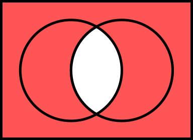
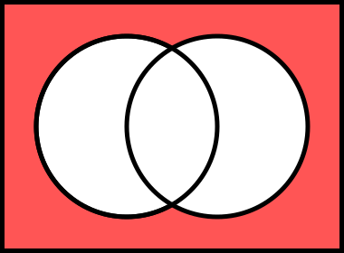

# 基本情報技術者試験の勉強メモ

ここには基本情報技術者試験の合格するために、勉強したことをメモしています。

基本上技術者試験はIPAが実施し、経済産業省が認定する日本の国家試験。

合格時のメリットとして、ITエンジニアに必要となる基礎的な知識が身につく。

試験の科目Aの分野は、テクノロジ系、マネジメント系、ストラテジ系の3つ。
最近はセキュリティに関する問題が多め。

科目Bの分野は、アルゴリズムとプログラミング、情報セキュリティの2つ。

## 基礎理論1

### データの単位

| 単位     | 記号 | 10進数表記        | 累乗    |
| -------- | ---- | ----------------- | ------- |
| テラ     | T    | 1,000,000,000,000 | 10**12  |
| ギガ     | G    | 1,000,000,000     | 10**9   |
| メガ     | M    | 1,000,000         | 10**6   |
| キロ     | K    | 1,000             | 10**3   |
| 基準     |      | 1                 | 1       |
| ミリ     | m    | 0.001             | 10**-3  |
| マイクロ | u    | 0.000001          | 10**-6  |
| ナノ     | n    | 0.000000001       | 10**-9  |
| ピコ     | p    | 0.000000000001    | 10**-12 |

### 数値の数え方

少数は整数部、少数部の2つに分かれる。

有限小数とは、少数部の桁数に限りがある少数。
無限小数とは、少数部の桁数に限りがない少数。
循環小数とは、同じ数字の列が無限に繰り返される少数。

### 基数変換と桁の重み

数値の表記法の変換を基数変換という。

指数とは数を掛け合わせる回数を表す数字。

1001.001=9.125、この少数部の計算は2-3乗は1/8なので125となる。

### 様々な基数変換

2bd.c8=701.78125、まず10進数に変換、桁の重みを乗算し、最後に足し合わせる。

10から2進数の場合、整数部では2で割って行き、あまりを加える。
少数部は少数を2でかけて行き、整数部を並べる。

10から16進数は10から2の計算方法と同じ。

### 負の2進数

2進数で負の整数を表す方法は、絶対値表現、1の補数表現、2の補数表現がある。

### 2進数の四則演算

2進数のシフト演算は、ビットを左右にずらして掛け算や割り算を行う計算手法。

論理シフトは正負を考慮せず、算術シフトは考慮を行う。

シフト演算は、例えばビットを左に2つずらすと、2**2=4倍になる。
そこに元のビットを加えると4+1=5倍となる。
そこに左に1つシフトすれば、5*2=10倍となり、計算が楽になる。

## 基礎理論2

### 集合と論理積

論理演算子には、AND,OR,XOR,NOTがある。

**AND演算子**

| A | B | A AND B |
| - | - | ------- |
| 0 | 0 | 0       |
| 0 | 1 | 0       |
| 1 | 0 | 0       |
| 1 | 1 | 1       |


**OR演算子**

| A | B | A OR B |
| - | - | ------ |
| 0 | 0 | 0      |
| 0 | 1 | 1      |
| 1 | 0 | 1      |
| 1 | 1 | 1      |


**XOR演算子**

| A | B | A XOR B |
| - | - | ------- |
| 0 | 0 | 0       |
| 0 | 1 | 1       |
| 1 | 0 | 1       |
| 1 | 1 | 0       |


**NOT演算子**

| A | NOT A |
| - | ----- |
| 1 | 0     |
| 0 | 1     |

そのほかに、NAND,NORがある。

**NAND演算子**

| A | B | A NAND B |
| - | - | -------- |
| 0 | 0 | 1        |
| 0 | 1 | 1        |
| 1 | 0 | 1        |
| 1 | 1 | 0        |



**NOR演算子**

| A | B | A NOR B |
| - | - | ------- |
| 0 | 0 | 1       |
| 0 | 1 | 0       |
| 1 | 0 | 0       |
| 1 | 1 | 0       |



論理演算子の優先順位は、括弧>NOT>AND>ORの順。

問題には、ベン図とビット列と16進数を組み合わせた計算が出てくる。

### 論理回路

論理回路とは、論理演算を行う電子部品。

MIL記号とは、論理回路を紙面上に表す際に使用される記号。

問題では複雑な論理回路が最終的にどのようなノン理演算を行っているかが主題される。

論理回路の問題では、ベン図を用いて解くと良い。

2進数の足し算を行う論理回路を加算回路という。

加算回路には、半加算器、全加算器の2種類がある。

半加算器は下のくらいからの桁上がりを考慮しない加算回路。

| 入力 | 出力 |
| ---- | ---- |
| X Y  | C S  |
| 0 0  | 0 0  |
| 0 1  | 0 1  |
| 1 0  | 0 1  |
| 1 1  | 1 0  |

全加算器は下のくらいからの桁上がりを考慮する加算回路。

| 入力  | 出力 |
| ----- | ---- |
| X Y Z | C S  |
| 0 0 0 | 0 0  |
| 0 0 1 | 0 1  |
| 0 1 0 | 0 1  |
| 0 1 1 | 1 0  |
| 1 0 0 | 0 1  |
| 1 0 1 | 1 0  |
| 1 1 0 | 1 0  |
| 1 1 1 | 1 1  |

半加算器は論理積と排他的論理和で実現する。

### 計算式の表し方

計算式を表す方法には、中置記法、前置記法、後置記法がある。

中置記法とは、おなじみの記法。

Y=(A+B)X(C-D/E)

前置記法とは、数字の前に演算子を置く表記法で、ポーランド表記法とも呼ばれる。

Y+AB/-XCDE=

後置記法とは、数字の後に演算子を置く表記法で、逆ポーランド表記法とも呼ばれる。

YAB+CDE/-X=

### オートマトン

モデル化とは、現実世界にある複雑なものを単純化してわかりやすくすること。

オートマトンとは、機能を、入力、状態、出力の3つを表すシステムモデル。

オートマトンの状態で、最終的に行き着く状態のことを、受理状態という。

このような状態の遷移を表した表を状態遷移表、図を状態遷移図という。

問題では表、図が示され最終的な状態は何かが問われる。

### 人工知能

AI（人工知能）とは、人間の知的な振る舞いをコンピューター乗に再現する技術。

主な用途に、画像の認識・合成、自然言語処理、音声の認識・合成がある。

重要な用語は以下の通り。

- 機械学習
- ニューラルネットワーク
- ディープラーニング
- 生成AI

ニューラルネットワークの基本的な計算隊はニューロンで、プログラム乗で関数として実装される。

このニューロンに渡す値を出力する関数のことを活性化関数という。

ディープフェイクとは、本物みたいな偽物の音声や動画を作成する手法。

ハルシネーションとは、誤った情報を正しい情報として生成する現象。

ファインチューニングとは、AIに追加学習を行うこと。

## アルゴリズムとプログラミング

## データ構造

コンピューターが扱う情報のことをデータという。

データはコンピューター内にある主記憶装置に保存される。

この記憶装置乗のデータの並べ方をデータ構造という。

データ構造には、スタック、キュー、配列、連結リスト、木構造がある。


__スタック__

- 最後に格納したデータを最初に取り出すデータ構造（積み上げられた本）
- スタックにデータを格納することをプッシュ、取り出すことをポップという。
- アルゴリズムは後入れ先出し（LIFO: Last In First Out）

__キュー__

- 最初に格納したデータを最初に取り出すデータ構造（レジ待ちの列）
- キューにデータを格納することをエンキュー、取り出すことをデキューという。
- アルゴリズムは先入先出し（FIFO: First In First Out）

__配列__

- データを表の形に並べたデータ構造。
- 配列では1つ1つを要素、位置を表す番号を要素番号という。
- 配列で要素が一直線に並ぶ配列を1次元配列、縦横に並ぶ配列を2次元配列という。

__連結リスト__

- データを数珠繋ぎに並べたデータ構造
- 連結リストのポインタとは、次の要素のアドレスを指し示すもの。
- 配列と連結リストの違いは、配列は参照と更新が速く、連結リストは挿入と削除が速い。

__木構造__

- 階層構造を持つデータ構造。
- 最上位の節を根、枝分かれする箇所を節、末端を葉と呼ぶ。
- ２分探索木とは、左の子孫＜親＜右の子孫の関係になっていることをいう。
- 木構造で大小関係を求められた場合は、右から左と覚えておくと良い。

### アルゴリズムの基本

アルゴリズムとは、問題を解決するときの手順。

アルゴリズムには、文章、流れ図、数式、プログラム言語の4つの方法で表現することができる。

問題では、流れ図が最も頻繁に出題される。

#### 文章

```
1. x<0ならば2へ。x>=0ならば3へ
2. -x->x
3. xを返す
```

#### 流れ図

| 記号名   | 形     | 役割                             |
| ------   | ------ | -------------------------------- |
| 端子     | 楕円形 | 流れ図の開始と終了を表す         |
| 処理     | 四角形 | 計算や値の代入といった処理を表す |
| 判断     | ひし形 | 処理を分岐するための条件を表す   |
| 線       | 線形   | 処理の順番を表す                 |
| ループ端 | 台形   | 繰り返し処理の開始と終了を表す   |

#### 数式

```
      |- -x (x<0の時)
f(x)=-|
      |- x (x>=0の時)
```

#### プログラム言語

```sh
f(x): if x < 0 then return -x else return x
```

### アルゴリズムの分類

試験では、整列、探索、再帰的アルゴリズムが出題される。

#### 整列アルゴリズム

整列アルゴリズムとは、データを特定の順番に並べるアルゴリズム。

主な整列アルゴリズムは以下の4つで、特にクイックソートが最も出題される。

| 種類           | 解説                                           |
| -------------- | ---------------------------------------------- |
| バブルソート   | 隣り合ったデータを比較する                     |
| 選択ソート     | 先頭から順に最小値を選択し、データを交換する   |
| 挿入ソート     | 未整列のデータを適切な場所に挿入する           |
| クイックソート | 基準値を決めて、それより大小のグループに分ける |

#### 探索アルゴリズム

探索アルゴリズムには以下の種類がある。

特にハッシュ法、2分探索法がよく出題される。

| 種類       | 説明                         |
| ---------- | ---------------------------- |
| 線形探索法 | 先頭から順に1つずつ照合する  |
| ハッシュ法 | ハッシュ表を使用する         |
| 2分探索法  | 調べる範囲を半分に切り分ける |

ハッシュ法ではまず、ハッシュ関数を使って値をハッシュ値に変換します。
そしてハッシュ値を要素番号とした配列の要素に格納される。
ハッシュ法のデメリットは、衝突が起こる可能性があること。

2分探索法には、データをあらかじめ整列する必要がある、2つに分けながら探索するという特徴があります。

再帰的アルゴリズムとは、処理の途中で自分自身を呼び出すアルゴリズム。

試験では総和、剰余、階上を求める際に出題される。

総和はΣ、剰余はmod、階乗は!で表す。

アルゴリズムを完了するために必要な計算量をオーダーという。

| アルゴリズム   | オーダー記法         |
| -------------- | -------------------- |
| ハッシュ法     | O(1)                 |
| 2分探索法      | O(log2n) or O(log n) |
| 線形探索法     | O(n)                 |
| クイックソート | O(n log n)           |

表の`log`は対数を表すキーワードで、指数を表す1つの方法です。

### プログラムの性質と種類

プログラムとは、コンピューターに対する命令書。

プログラムの性質には以下の4つがある。

この中で、再起、再入可能がよく試験で出題される。

| 性質       | 説明                                             |
| ---------- | ------------------------------------------------ |
| 再帰       | 自分自身を呼び出す性質                           |
| 再入可能   | 複数のプログラムからの同時呼び出しに対応可能     |
| 再配置可能 | 主記憶装置に保存していればどこでも実行が可能     |
| 再使用可能 | 主記憶に保存して主記憶装置から繰り返し実行できる |

Javaアプレットとは、Webブラウザ上で実行可能なプログラム。

Javaサーブレットとは、動的なWebページを作るためのプログラム。

JavaBeansとは、コンポーネント化されたプログラム。

### その他の言語

HTMLはマークアップ言語。

XMLはHTMLと違い拡張が可能（タグを自分で定義できる）。

CSSはHTMLのスタイルを指定する言語。

Ajax(Asynchronous JavaScript and XML)とは、画面遷移せずに動的なUIを実現する技術。

