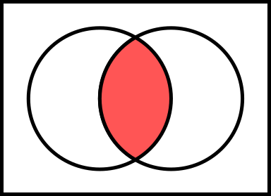
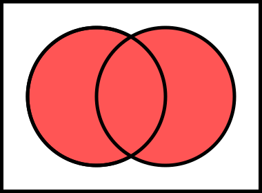

# 基本情報技術者試験の勉強メモ

ここには基本情報技術者試験の合格するために、勉強したことをメモしています。

基本上技術者試験はIPAが実施し、経済産業省が認定する日本の国家試験。

合格時のメリットとして、ITエンジニアに必要となる基礎的な知識が身につく。

試験の科目Aの分野は、テクノロジ系、マネジメント系、ストラテジ系の3つ。
最近はセキュリティに関する問題が多め。

科目Bの分野は、アルゴリズムとプログラミング、情報セキュリティの2つ。

## 基礎理論1

データの単位

| 単位     | 記号 | 10進数表記        | 累乗    |
| -------- | ---- | ----------------- | ------- |
| テラ     | T    | 1,000,000,000,000 | 10**12  |
| ギガ     | G    | 1,000,000,000     | 10**9   |
| メガ     | M    | 1,000,000         | 10**6   |
| キロ     | K    | 1,000             | 10**3   |
| 基準     |      | 1                 | 1       |
| ミリ     | m    | 0.001             | 10**-3  |
| マイクロ | u    | 0.000001          | 10**-6  |
| ナノ     | n    | 0.000000001       | 10**-9  |
| ピコ     | p    | 0.000000000001    | 10**-12 |

少数は整数部、少数部の2つに分かれる。

有限小数とは、少数部の桁数に限りがある少数。
無限小数とは、少数部の桁数に限りがない少数。
循環小数とは、同じ数字の列が無限に繰り返される少数。

数値の表記法の変換を基数変換という。

指数とは数を掛け合わせる回数を表す数字。

1001.001=9.125、この少数部の計算は2-3乗は1/8なので125となる。

2bd.c8=701.78125、まず10進数に変換、桁の重みを乗算し、最後に足し合わせる。

10から2進数の場合、整数部では2で割って行き、あまりを加える。
少数部は少数を2でかけて行き、整数部を並べる。

10から16進数は10から2の計算方法と同じ。

2進数で負の整数を表す方法は、絶対値表現、1の補数表現、2の補数表現がある。

2進数のシフト演算は、ビットを左右にずらして掛け算や割り算を行う計算手法。

論理シフトは正負を考慮せず、算術シフトは考慮を行う。

シフト演算は、例えばビットを左に2つずらすと、2**2=4倍になる。
そこに元のビットを加えると4+1=5倍となる。
そこに左に1つシフトすれば、5*2=10倍となり、計算が楽になる。

## 基礎理論2

### 集合と論理積

論理演算子には、AND,OR,XOR,NOTがある。

**AND演算子**

| A | B | A AND B |
| - | - | ------- |
| 0 | 0 | 0       |
| 0 | 1 | 0       |
| 1 | 0 | 0       |
| 1 | 1 | 1       |

**OR演算子**

| A | B | A OR B |
| - | - | ------ |
| 0 | 0 | 0      |
| 0 | 1 | 1      |
| 1 | 0 | 1      |
| 1 | 1 | 1      |

**XOR演算子**

| A | B | A XOR B |
| - | - | ------- |
| 0 | 0 | 0       |
| 0 | 1 | 1       |
| 1 | 0 | 1       |
| 1 | 1 | 0       |

**NOT演算子**

| A | NOT A |
| - | ----- |
| 1 | 0     |
| 0 | 1     |

そのほかに、NAND,NORがある。

**NAND演算子**

| A | B | A NAND B |
| - | - | -------- |
| 0 | 0 | 1        |
| 0 | 1 | 1        |
| 1 | 0 | 1        |
| 1 | 1 | 0        |

**NOR演算子**

| A | B | A NOR B |
| - | - | ------- |
| 0 | 0 | 1       |
| 0 | 1 | 0       |
| 1 | 0 | 0       |
| 1 | 1 | 0       |

論理演算子の優先順位は、括弧>NOT>AND>ORの順。

問題には、ベン図とビット列と16進数を組み合わせた計算が出てくる。

### 論理回路

論理回路とは、論理演算を行う電子部品。

MIL記号とは、論理回路を紙面上に表す際に使用される記号。

問題では複雑な論理回路が最終的にどのようなノン理演算を行っているかが主題される。

論理回路の問題では、ベン図を用いて解くと良い。

2進数の足し算を行う論理回路を加算回路という。

加算回路には、半加算器、全加算器の2種類がある。

半加算器は下のくらいからの桁上がりを考慮しない加算回路。

| 入力 | 出力 |
| ---- | ---- |
| X Y  | C S  |
| 0 0  | 0 0  |
| 0 1  | 0 1  |
| 1 0  | 0 1  |
| 1 1  | 1 0  |

全加算器は下のくらいからの桁上がりを考慮する加算回路。

| 入力  | 出力 |
| ----- | ---- |
| X Y Z | C S  |
| 0 0 0 | 0 0  |
| 0 0 1 | 0 1  |
| 0 1 0 | 0 1  |
| 0 1 1 | 1 0  |
| 1 0 0 | 0 1  |
| 1 0 1 | 1 0  |
| 1 1 0 | 1 0  |
| 1 1 1 | 1 1  |

半加算器は論理積と排他的論理和で実現する。

### 計算式の表し方

計算式を表す方法には、中置記法、前置記法、後置記法がある。

中置記法とは、おなじみの記法。

Y=(A+B)X(C-D/E)

前置記法とは、数字の前に演算子を置く表記法で、ポーランド表記法とも呼ばれる。

Y+AB/-XCDE=

後置記法とは、数字の後に演算子を置く表記法で、逆ポーランド表記法とも呼ばれる。

YAB+CDE/-X=

### オートマトン

モデル化とは、現実世界にある複雑なものを単純化してわかりやすくすること。

オートマトンとは、機能を、入力、状態、出力の3つを表すシステムモデル。

オートマトンの状態で、最終的に行き着く状態のことを、受理状態という。

このような状態の遷移を表した表を状態遷移表、図を状態遷移図という。

問題では表、図が示され最終的な状態は何かが問われる。

### 人工知能

AI（人工知能）とは、人間の知的な振る舞いをコンピューター乗に再現する技術。

主な用途に、画像の認識・合成、自然言語処理、音声の認識・合成がある。

重要な用語は以下の通り。

- 機械学習
- ニューラルネットワーク
- ディープラーニング
- 生成AI

ニューラルネットワークの基本的な計算隊はニューロンで、プログラム乗で関数として実装される。

このニューロンに渡す値を出力する関数のことを活性化関数という。

ディープフェイクとは、本物みたいな偽物の音声や動画を作成する手法。

ハルシネーションとは、誤った情報を正しい情報として生成する現象。

ファインチューニングとは、AIに追加学習を行うこと。

